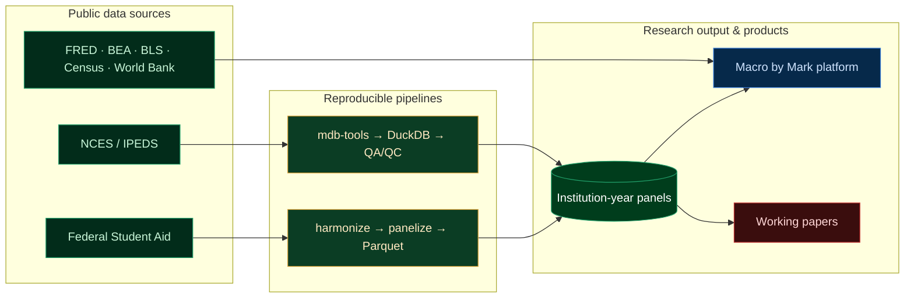

<div align="center">


<a href="https://git.io/typing-svg">
  
</a>

<br/>


</div>

---

## ◆ Who I am

I build **research-grade data systems** for messy administrative datasets and use them to study **higher-education finance, student aid, college pricing, and macroeconomic questions.**

MA in Quantitative Business Economics, University of Nevada, Las Vegas. My work sits across **economics, data engineering, empirical research, and technical communication** — I write the pipeline, run the regression, and ship the platform.

<div align="center">

### By the numbers


-0b8a45?style=flat-square)


</div>

---

## ◆ Featured work

### 🟢 [Macro by Mark](https://github.com/markjayson13/macrobymark) — *live U.S. macroeconomic research platform*


Indicators, release calendars, dashboards, forecasting, and reference workflows — integrating **FRED, BEA, BLS, Census, and World Bank** into one interactive surface for learning, analysis, and communication. Includes **Marco**, an AI macro assistant, and a live first-party **status / observability page**.

### 📊 [IPEDSDB_Panel](https://github.com/markjayson13/IPEDSDB_Panel) — *the 141,711 × 1,864 panel*


Reproducible Python + SQL pipeline that turns **20 years of raw NCES/IPEDS Access databases (2004–2023)** into a validated, **unbalanced UNITID-by-year panel** — `141,711 rows × 1,864 columns`, **39/39 QA checks passed.** Built with `mdb-tools` extraction → DuckDB harmonization → QA/QC gate → research-ready export.

### 💵 [FSAVolumeReports_Panel](https://github.com/markjayson13/FSAVolumeReports_Panel) — *Federal Student Aid, panelized*


Downloads, harmonizes, panelizes, QA-checks, and exports **25+ years of Federal Student Aid Title IV volume reports** into clean **institution-by-award-year** panels for grants, campus-based aid, and loans.

### 📰 [econ495journal_ops](https://github.com/markjayson13/econ495journal_ops) — *academic publishing pipeline*


Backend ops + admin portal for the **UNLV ECON 495 working-paper series**: intake, metadata validation, document processing (Pandoc/LaTeX), and sync to the public site.

### 🎨 [markjaysonwebsite-v2](https://github.com/markjayson13/markjaysonwebsite-v2) · [creative-markjayson](https://github.com/markjayson13/creative-markjayson) — *portfolio*


Personal and creative portfolio sites, built with Astro and deployed on Cloudflare Pages.

---

## ◆ Engineering I shipped recently

Live observability for **Macro by Mark** — a status page that probes the app's own endpoints and folds in vendor health, built to **fail loud, never lie green.**

<details>
<summary><b>Strict-mode health endpoints</b> — one route, two contracts</summary>

```ts
// Callers get 200-with-checks (backward compatible).
// Uptime probes pass ?strict=1 and get a real 503 when config is broken.
const STRICT_CHECK_KEYS = ["fredConfigured", "supabaseConfigured"] as const;

const strict = request.nextUrl.searchParams.get("strict") === "1";
const strictFailed = strict && STRICT_CHECK_KEYS.some((k) => !checks[k]);

return NextResponse.json(
  { checks, service: "macro-by-mark", status: strictFailed ? "degraded" : "ok" },
  { status: strictFailed ? 503 : 200, headers: { "cache-control": "no-store" } }
);
```
</details>

<details>
<summary><b>The Marco sentinel</b> — health-check a streaming endpoint without burning model credit</summary>

```ts
// /api/chat is POST-only and streams tokens — you can't ping it cheaply.
// So a GET sentinel validates the *config* the model depends on,
// without ever invoking the model.
function evaluateChatHealth() {
  const anthropicKeyConfigured = Boolean(process.env.ANTHROPIC_API_KEY);
  const chatTierConfigPopulated = Boolean(CHAT_TIER_CONFIG.visitor && CHAT_TIER_CONFIG.free);
  const rateLimitUpstreamConfigured =
    Boolean(process.env.UPSTASH_REDIS_REST_URL && process.env.UPSTASH_REDIS_REST_TOKEN);
  // → { ok, reason: "anthropic_key_missing" | "chat_tier_config_missing" | ... }
}
```
</details>

<details>
<summary><b>Defensive vendor aggregation</b> — a third party's outage can't take down my status page</summary>

```ts
// Each probe: 4s AbortController timeout, 60s cache, try/catch → null.
// A failed probe becomes an "unknown" chip. The page always renders.
async function fetchJson<T>(path: string, token: string): Promise<T | null> {
  const controller = new AbortController();
  const timeout = setTimeout(() => controller.abort(), FETCH_TIMEOUT_MS);
  try {
    const res = await fetch(`${API_BASE}${path}`, {
      headers: { authorization: `Bearer ${token}` },
      next: { revalidate: 60 },
      signal: controller.signal
    });
    return res.ok ? ((await res.json()) as T) : null;
  } catch {
    return null;            // partial outage upstream ≠ crash downstream
  } finally {
    clearTimeout(timeout);
  }
}
```
</details>

Plus a **pluggable monitoring source** (`STATUS_FIRST_PARTY_PROVIDER` = `betterstack` | `instatus` | `statuspage` | `none`) so the vendor is an env var, not a code commitment — and a four-tier indicator fold with **worst-of-fold** roll-up.



---

## ◆ Research & output

- 📄 Published **"Revisiting Bennett's Hypothesis"** in *Spectra Undergraduate Research Journal* (2025)
- 🎙️ Presented at **WEAI's 100th Annual Conference**
- 📚 Authored **4 working papers** on higher-ed pricing, financial aid packaging, and federal cost-of-attendance policy
- 🏛️ Helped build the **UNLV Undergraduate Economics Working Paper Series**

**Research focus:** higher-education pricing · financial-aid packaging · federal cost-of-attendance policy · panel econometrics · causal inference · dynamic specifications · large-scale data validation.

---

## ◆ Teaching & mentorship

At UNLV I supported instruction across economics, statistics, econometrics, and senior capstone research:

- Delivered lectures and review sessions for **200+ students per semester**
- Built lecture materials and quantitative course-support resources
- Held high-volume office hours and one-on-one mentoring
- Mentored **10 undergraduate researchers** through end-to-end empirical projects

---

## ◆ Tech stack

<div align="center">


</div>

| Area | Tools |
|---|---|
| **Data engineering** | Python · pandas · DuckDB · SQL · PyArrow · mdb-tools |
| **Econometrics** | Stata · R · Excel |
| **Front end** | Next.js · TypeScript · React · Tailwind · Zustand |
| **Infra / services** | Supabase · Vercel · Trigger.dev · Upstash · Stripe |
| **Data sources** | NCES/IPEDS · Federal Student Aid · FRED · BEA · BLS · Census · World Bank |

---

## ◆ GitHub

<div align="center">


</div>

---

## ◆ Connect

<div align="center">

[](https://www.markjayson.com/)
[](https://www.linkedin.com/in/markjaysonfarol/)
[](mailto:markjayson@markjayson.com)

</div>

> **Open to** Economist, Research Analyst, Data Analyst, and Financial Analyst roles — remote, hybrid, or relocation.


