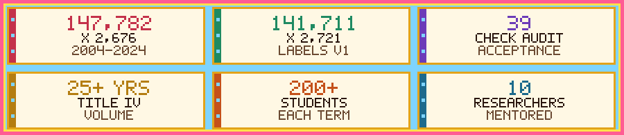
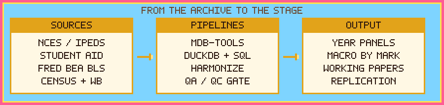
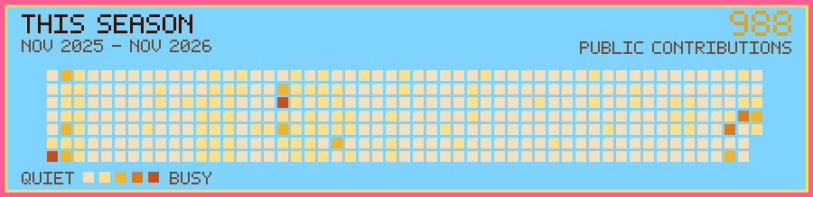

<picture>
  <source media="(prefers-color-scheme: dark)" srcset="assets/hero-dark.svg" />
  <source media="(prefers-color-scheme: light)" srcset="assets/hero-light.svg" />
  
</picture>

I build **research-grade data systems** for messy administrative datasets and use them to study **higher-education finance, student aid, college pricing, and macroeconomic questions.**

M.A. in Quantitative Business Economics and B.S.B.A. in Economics with a theatre minor, University of Nevada, Las Vegas. The work sits across economics, data engineering, empirical research, and technical communication: I write the pipeline, run the regression, and ship the platform.

Open to **Economist, Research Analyst, Data Analyst, and Financial Analyst** roles. Remote, hybrid, or relocation.

<picture>
  <source media="(prefers-color-scheme: dark)" srcset="assets/stats-dark.svg" />
  <source media="(prefers-color-scheme: light)" srcset="assets/stats-light.svg" />
  
</picture>

The **2004–2024** consolidated IPEDS analysis file is **147,782 rows × 2,676 columns**. Labeled release `full-panel-labels-v1` is **141,711 rows × 2,721 columns**. Builds run a **39-check acceptance audit**.

  

## Act I — The economist

<b>Open the curtain — program notes</b>

I immigrated to the United States from the Philippines at 14.

Founder and sole employee of **Mark Jayson Nation LLC** (Las Vegas, formed October 2026). The house ships [Macro by Mark](https://macrobymark.com), an economics learning and U.S. macro research platform; [getriff](https://get-riff.com), an iOS workout app in TestFlight; and a Macro by Mark island-tycoon game now in development.

I edit UNLV's Undergraduate Economics Working Paper Series, which I helped build.

**Research focus:** higher-education pricing, financial-aid packaging, federal cost-of-attendance policy, panel econometrics, causal inference, dynamic specifications, and large-scale data validation.

### On the research bill

- Published **"Revisiting Bennett's Hypothesis"** in *Spectra Undergraduate Research Journal* (2025)
- Presented at **WEAI's 100th Annual Conference**
- Authored **4 working papers** on higher-ed pricing, financial aid packaging, and federal cost-of-attendance policy
- Helped build, and now edit, the **UNLV Undergraduate Economics Working Paper Series**

### Teaching and mentorship

At UNLV I supported instruction in economics, statistics, econometrics, and senior capstone research: lectures and review sessions for **200+ students a semester**, course materials, high-volume office hours, and **10 undergraduate researchers** mentored through end-to-end empirical projects.

## Act II — The work

### Now playing

Indicators, release calendars, dashboards, forecasting, and reference workflows. Integrates **FRED, BEA, BLS, Census, and World Bank**, with **Marco**, an AI macro assistant, and a status page built to **fail loud, never lie green.**

iOS workout app, in TestFlight.

A Macro by Mark island-tycoon game is in development.

### The data season

Reproducible Python and SQL pipeline from NCES/IPEDS Access databases to unbalanced UNITID-by-year panels. The **2004–2024** consolidated analysis file is **147,782 × 2,676**. Labeled release `full-panel-labels-v1` is **141,711 × 2,721**.

Downloads, harmonizes, panelizes, QA-checks, and exports **25+ years** of Federal Student Aid Title IV volume reports into institution-by-award-year panels for grants, campus-based aid, and loans.

Links those FSA volume reports to IPEDS institutions, aligns aid periods, and exports combined research panels.

Python and DuckDB pipeline that downloads, harmonizes, QC-validates, and panelizes NCES IPEDS into research-ready institution-year datasets.

Public replication code for research on cost-of-attendance headroom and institutional grant aid, built from the IPEDS panel. Baseline sample: four-year Title IV public and private nonprofit institutions, 2009–2023.

### Scenery

Personal site, Astro on Cloudflare Pages. Live at [markjayson.com](https://markjayson.com).

Creative portfolio, Astro on Cloudflare Pages. Live at [creative.markjayson.com](https://creative.markjayson.com).

<b>Open the curtain — how a panel gets made</b>

**IPEDSDB_Panel** extracts annual IPEDS Access databases with `mdb-tools`, harmonizes them in DuckDB, and writes a research-ready UNITID-by-year panel. The extended **2004–2024** consolidated analysis file is 147,782 rows × 2,676 columns. The labeled release `full-panel-labels-v1` is 141,711 rows × 2,721 columns. A **39-check acceptance audit** gates the build.

**FSAVolumeReports_Panel** keeps the Federal Student Aid side at the OPEID-by-award-year grain: acquisition, identity normalization, program harmonization, and suppression handling for grants, campus-based aid, and loans, across 25+ years of Title IV volume.

**IPEDS-FSA_Panel** consumes both outputs, resolves annual UNITID links, and exports the combined research panels. It does not rebuild either upstream panelizer.

**IPEDS_Paneling** is the separate Python and DuckDB lane for downloading, harmonizing, and QC-validating NCES IPEDS into institution-year datasets.

**COA_FINAID_SUBS** is the public replication layer for cost-of-attendance headroom and institutional grant aid. It starts from the clean IPEDS panel, builds the 2009–2023 four-year public and private nonprofit sample, and estimates institution-level fixed effects. Those estimates are associations, not student-level packaging results.

<b>Open the curtain — house lights</b>

Macro by Mark's status page probes the app's own endpoints and folds in vendor health. Strict-mode checks return a real failure when configuration is broken, instead of a cheerful 200. A sentinel validates the chat config without calling the model. Vendor probes time out, cache, and degrade to "unknown," so a third-party outage cannot take the page down. The monitoring vendor is an environment variable (`betterstack`, `instatus`, `statuspage`, or `none`), and indicator groups roll up worst-of-fold.

<picture>
  <source media="(prefers-color-scheme: dark)" srcset="assets/pipeline-dark.svg" />
  <source media="(prefers-color-scheme: light)" srcset="assets/pipeline-light.svg" />
  
</picture>

## Intermission — Instruments

| Area | Tools |
| --- | --- |
| **Data engineering** | Python · pandas · DuckDB · SQL · PyArrow · mdb-tools |
| **Econometrics** | Stata · R · Excel |
| **Front end** | Next.js · TypeScript · React · Tailwind · Zustand |
| **Infra / services** | Supabase · Vercel · Trigger.dev · Upstash · Stripe |
| **Data sources** | NCES/IPEDS · Federal Student Aid · FRED · BEA · BLS · Census · World Bank |

Portfolio sites are Astro on Cloudflare Pages.

## This season

<picture>
  <source media="(prefers-color-scheme: dark)" srcset="assets/quest-log-dark.svg" />
  <source media="(prefers-color-scheme: light)" srcset="assets/quest-log-light.svg" />
  
</picture>

The grid is redrawn from the public contribution calendar by a [scheduled Action](.github/workflows/quest-log.yml). The count in the card is GitHub's, and it updates when the calendar does.

## Curtain call

&nbsp;

&nbsp;

&nbsp;

Open to **Economist, Research Analyst, Data Analyst, and Financial Analyst** roles. Remote, hybrid, or relocation.

<picture>
  <source media="(prefers-color-scheme: dark)" srcset="assets/footer-dark.svg" />
  <source media="(prefers-color-scheme: light)" srcset="assets/footer-light.svg" />
  
</picture>

